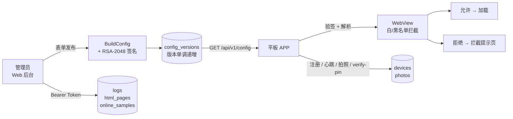

# 校园浏览器 · 服务端

**配置驱动的校园受管浏览器后端**：Web 后台图形化配置 → RSA 签名下发 → 平板强制白/黑名单 → 设备与日志可视化管控。


| 项 | 值 |
| --- | --- |
| 运行时 | ASP.NET Core 8 Minimal API（自包含发布，目标机无需装 .NET） |
| 数据 | SQLite（`data/campus.db`，WAL），备份 = 拷贝该文件 |
| 托管 | Windows 服务 `CampusBrowserServer`（首选）/ Linux systemd |
| 端口 | 默认 `8080`；优先级：命令行/环境变量 > `campus.port` > 默认 |
| 后台 | `http://服务器IP:8080/`（原生 HTML/JS，零构建依赖） |
| 初始账号 | `admin` / `test123456`；平板管理 PIN `123456` |

---

## 架构



三级兜底：**新配置（轮询）→ MMKV 本地缓存 → 首启未拉取成功则卡在设置页**。

---

## 功能

| 模块 | 能力 |
| --- | --- |
| **首页概览** | 在线数 / 总数 / 离线数 / 在线占比环形图；**今日 00:00→24:00 在线设备折线图**；默认 1 秒刷新，切走暂停 |
| **配置管理** | 首页与备用网址、白/黑名单规则（支持 `host:8080` 端口与路径前缀）、快捷书签、内置 HTML 页勾选、轮询间隔 30~86400s、kiosk、隐藏入口开关、截屏限制、启动拍照开关、可唤醒应用白名单、6 位平板 PIN |
| **版本管理** | 每次发布版本号 +1；一键回滚 = 用旧内容发**新**版本号（终端必收到） |
| **设备管理** | IP / APP 版本 / 配置版本 / 最后在线 / 拍照记录；在线/离线与关键词筛选；默认 1 秒自动刷新；CSV 导出（可选列 + 时间段） |
| **操作日志** | 登录 IP 与时间（成功 / 失败 / 被限频）、管理操作、设备上报；按事件/时间/关键词筛选 + 分页 + CSV 导出；保留 90 天 |
| **内置 HTML 页** | 后台在线编辑，服务端托管于 `/h/{页面片段}`，平板当书签/桌面快捷方式打开 |
| **安全** | 登录限频 5 次/分/IP、防用户名枚举、Token 6h 滑动续期、PIN 哈希不下发、配置签名、日志不记敏感内容、HTML 页 slug 白名单防穿越 |

---

## 快速开始

```bash
dotnet run                     # 默认 http://0.0.0.0:8080
dotnet run --urls http://0.0.0.0:9000
```

浏览器打开后进入初始化向导 → 设置管理员账号与首版配置 → 后台即可用。

## 构建安装包（Windows）

```bash
# 1) 自包含发布（csproj 已配裁剪/全球化/去调试符号）
dotnet publish CampusBrowser.Server.csproj -c Release -r win-x64 \
  --self-contained true -o installer/publish/win-x64      # 约 33 MB

# 2) NSIS 编译（Linux 用 -D，Windows 用 /D）
makensis -DAPP_VERSION=0.8.1 installer/campus-browser-server.nsi   # 产物约 11 MB
```

安装器：选项页设端口/目录/开机自启/桌面快捷方式 → 注册服务 → **安装完成即启动并等待端口就绪** → 放行防火墙 → 开始菜单 `.url` 后台入口。卸载默认保留 `data\campus.db`。

## 目录

```
Program.cs                 所有接口与启动逻辑
Models/AppConfig.cs        配置结构与请求 DTO（字段名即线上 JSON）
Services/
  Database.cs              SQLite：设置/版本/设备/令牌/日志/HTML页/在线采样
  AuditLog.cs              操作日志：内存队列 + 异步落库 + 高频事件节流
  OnlineSampler.cs         在线采样后台服务（每 5 秒，供首页全天曲线）
  Security.cs              PBKDF2 后台密码、平板 PIN 哈希
  Signer.cs                RSA-2048 配置签名
wwwroot/                   Web 后台（index.html 登录 / setup.html 向导 / admin.html 控制台 + pages/ + js/ + styles.css）
installer/                 NSIS 脚本 + 图标
data/                      运行后生成（已 gitignore）
```

---

## 接口

**APP / 公开**

> 以下 `/api/v1/*` 强制校验 UA：`User-Agent` 必须含 `OkHttp/`（APP 自带），浏览器/curl 会被 403 拒绝。

| 方法 | 路径 | 说明 |
| --- | --- | --- |
| GET | `/api/v1/config?device_id=` | 配置正文 + 头 `X-Config-Version` / `X-Signature`（剥离 PIN 哈希与 HTML 正文后重签） |
| POST | `/api/v1/devices/register` | 设备注册（名称 / APP 版本 / IP） |
| POST | `/api/v1/devices/heartbeat` | 心跳（IP 变化随之更新） |
| POST | `/api/v1/photo` | 照片上报：`type=startup\|wrong_pin`，JPEG ≤2MB |
| POST | `/api/v1/verify-pin` | PIN 哈希校验（每设备 60s 内 5 次，超出 429） |
| GET | `/api/v1/public-key` | 签名公钥（填进 APP 后启用验签） |
| GET | `/h/{slug}` | 内置 HTML 页（公开只读，可直接当书签） |
| GET | `/api/setup/status` · POST `/api/setup` · POST `/api/login` · POST `/api/logout` | 初始化与登录 |

**管理端**（`Authorization: Bearer <token>`）

| 方法 | 路径 | 说明 |
| --- | --- | --- |
| GET / POST | `/api/admin/config` · `/api/admin/config/publish` | 读取 / 发布新版本 |
| GET / POST | `/api/admin/config/versions` · `/api/admin/config/rollback?version=` | 版本列表 / 回滚 |
| GET | `/api/admin/devices` | 设备列表（含在线判定） |
| GET | `/api/admin/devices/export.csv?columns=&from=&to=` | 设备 CSV 导出 |
| GET | `/api/admin/photo?deviceId=&file=latest&type=` | 查看设备照片 |
| GET | `/api/admin/stats/overview` | 首页概览 + 今日在线采样点 |
| GET / POST | `/api/admin/html-pages` | HTML 页列表 / 新建更新（`id=0` 新建，slug 冲突即更新） |
| DELETE | `/api/admin/html-pages/{id}` | 删除 HTML 页 |
| GET | `/api/admin/logs?event=&from=&to=&q=&limit=&offset=` | 操作日志查询 |
| GET | `/api/admin/logs/export.csv` | 操作日志导出（UTF-8 BOM） |
| GET / POST | `/api/admin/pin` | 平板 6 位管理密码：读取状态 / 修改（留空保持不变；与配置版本解耦，发布或回滚都不动它） |
| GET | `/api/admin/public-key` | 查看公钥 |

---

## 配置字段（`schema_version` 恒为 1，新字段全部可选 + 默认值）

| 字段 | 说明 |
| --- | --- |
| `home_url` / `fallback_url` | 首页 / 备用网址 |
| `mode` | `whitelist`（只放行规则内）/ `blacklist`（仅拦截规则内） |
| `rules[]` | `*.example.edu.cn`、`host:8080`、`https://host/*`、精确网址；匹配不看协议 |
| `bookmarks[{title,url}]` | 快捷书签；白名单模式下**自动放行** |
| `html_pages[{slug,title}]` | 内置 HTML 页元数据（正文不下发，由 `/h/{slug}` 提供） |
| `allowed_apps[{package,label,scheme}]` | 可唤醒应用白名单 |
| `update_interval_seconds` | 平板轮询间隔（30~86400） |
| `hidden_entry_enabled` | 是否允许平板隐藏管理入口（默认 true） |
| `block_screenshot` | 是否禁止截屏/录屏（默认 true） |
| `require_startup_photo` | 启动是否必须前置拍照（默认 false） |
| `kiosk` | 全屏锁定 |

> 平板 6 位管理密码**不再属于配置字段**（v0.8.3 起存服务端 `settings` 表，键 `admin_pin_hash`）：发布与回滚配置都不会改动它，也永不下发。

## 数据表

| 表 | 关键字段 | 保留策略 |
| --- | --- | --- |
| `settings` | 键值（管理员哈希、RSA 密钥对、平板 PIN 哈希） | — |
| `config_versions` | version / config_json / signature / is_current | 保留最近 50 条列表 |
| `devices` | device_id / ip_address / last_seen / 拍照时间 | — |
| `auth_tokens` | token / expires_at | 过期惰性清理 |
| `logs` | ts / event / ip / actor / device_id / detail | 90 天 |
| `html_pages` | slug / title / html | — |
| `online_samples` | ts / online / total | 7 天 |

照片：`data/photos/{device_id}/{startup|wrong_pin}/`，按天清理保留 7 天。

## 安全

- 登录限频 5 次/分/IP；用户名不存在与密码错误**响应一致**（防枚举）
- **APP 请求强制 UA 校验**（v0.8.3 起常开）：`/api/v1/*` 只接受 `User-Agent` 含 `OkHttp/` 的客户端（即 APP ≥ v0.7.0），其余一律 403 `{"error":"非法客户端"}`；`/h/{slug}` 例外（平板 WebView 打开）
- 后台静态资源带 `Cache-Control: no-store`（.html/.js）+ `X-Content-Type-Options: nosniff`；页面另加 `X-Frame-Options: DENY`、`Referrer-Policy: no-referrer` 与 CSP；后台登录令牌存 `sessionStorage`（关标签页即失效）
- Token 192 位 CSPRNG，6h TTL + 滑动续期；`/api/logout` 需鉴权
- 配置 RSA-2048 签名；下发前剥离 `admin_pin_hash` 与 HTML 正文并**重新签名**
- 全部 SQL 参数化；后台动态输出全部 HTML 转义（已修复存储型 XSS）
- 不返回 `Server` 头；HTML 页响应带 `X-Content-Type-Options: nosniff` 与 `Referrer-Policy: no-referrer`
- 日志**绝不记录**密码、PIN 哈希与令牌
- 内网默认 HTTP；生产建议 HTTPS 反代或启用 TLS

## 协议

GPL-3.0
